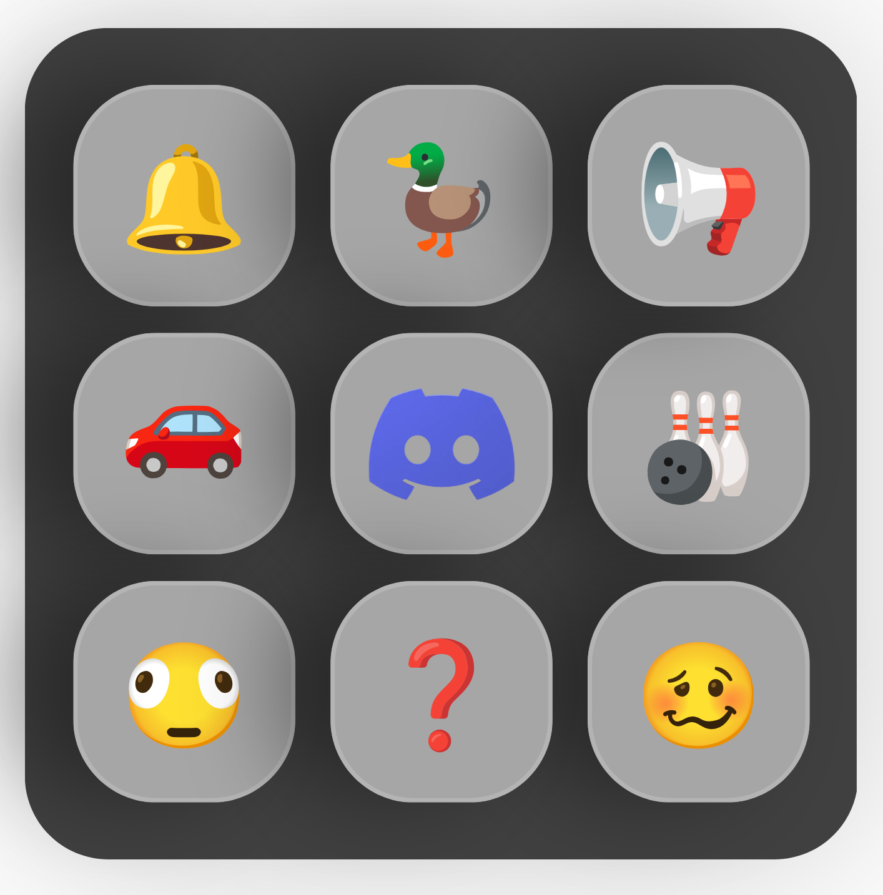
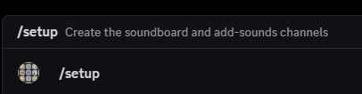
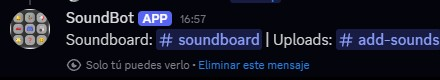
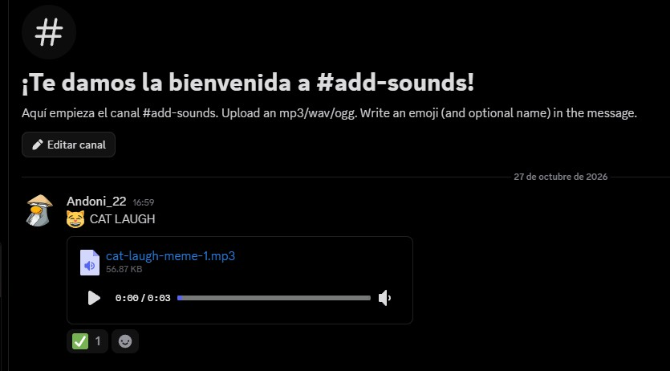
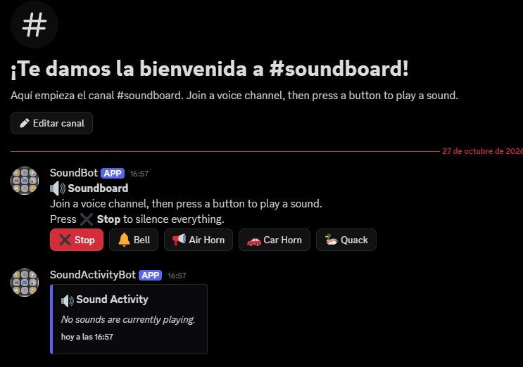
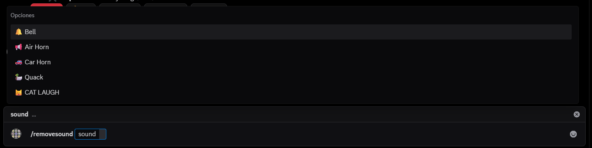
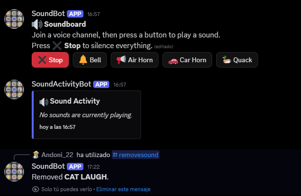

# Discord Soundboard Bot

<p align="center">
  
</p>

<p align="center">
  
  
  
</p>

A Discord bot that lets a voice channel play short sound clips from animated emoji buttons.

## How it works

### 1. Run /setup

`/setup` creates the `#soundboard` and `#add-sounds` channels for your server.




### 2. Add sounds

Upload an `.mp3`, `.wav` or `.ogg` file in `#add-sounds` with an emoji first in the message, for example `😸 CAT LAUGH`.



### 3. Use the soundboard

Join a voice channel, open `#soundboard`, and press a sound button to play it.



### 4. Remove sounds

`/removesound` shows a list of current sounds and allows you to delete one






### 5. Leave


`/leave` forces the bot to leave the voice chat. If nobody is present for 5 seconds it will leave on its own, this command just forces it lo leave even with people in it.

---

## 1. Create the Discord bot

1. Go to <https://discord.com/developers/applications> and create a **New Application**.
2. **Bot** tab: click **Reset Token** and copy it. Turn on **Message Content Intent**.
   Turn **Public Bot** off if you want to keep it private.
3. **Installation** tab: set **Install Link** to **None** (required for private bots).
4. **OAuth2 > URL Generator**: scopes `bot` and `applications.commands`, permissions:
   View Channels, Send Messages, Read Message History, Connect, Speak, Use Voice Activity, Manage Channels.
5. Open the generated URL and add the bot to your server.

## 2. Run it (Docker)

```bash
git clone https://github.com/YOUR_USER/YOUR_REPO.git
cd YOUR_REPO
cp .env.example .env        # then edit .env and paste your token
docker compose up -d --build
```

Then run `/setup` in your Discord server once.

| Task            | Command                                     |
|-----------------|---------------------------------------------|
| View logs       | `docker compose logs -f`                    |
| Update          | `git pull && docker compose up -d --build`  |
| Stop            | `docker compose down`                       |

Uploaded sounds and state are stored in the `soundbot-data` Docker volume, so they survive updates.

## License

This project is licensed under the GNU General Public License v3.0 (GPL-3.0). See [LICENSE](LICENSE) for details.
